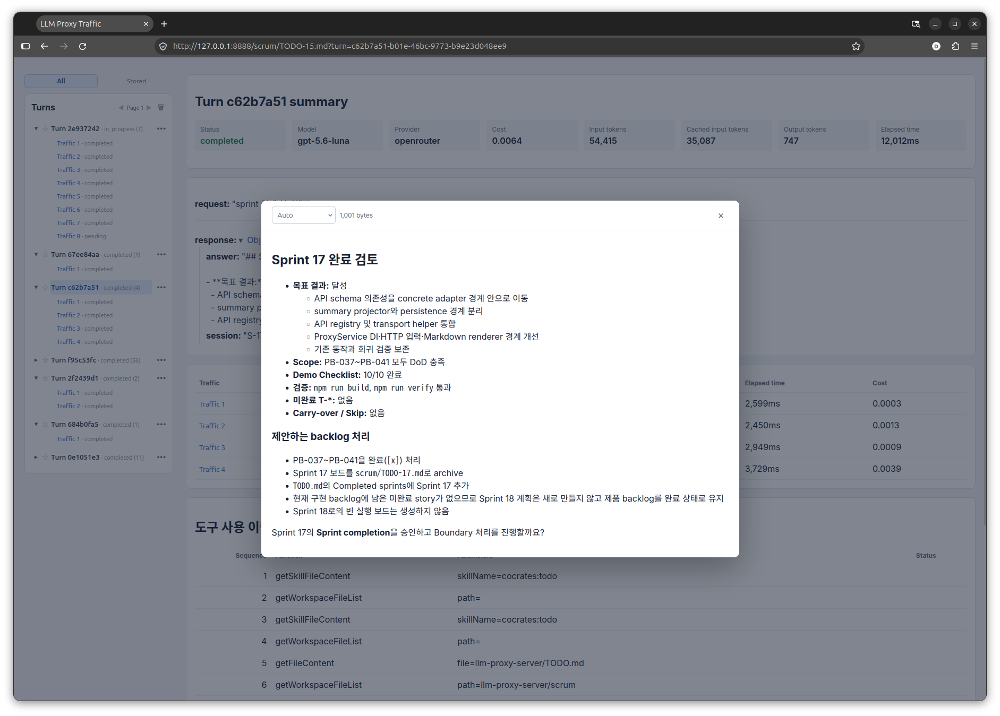

# LLM Proxy Server

단일 프로세스로 실행되는 localhost LLM Proxy입니다. Fastify API/server와 React monitoring UI가 하나의 프로세스에서 동작합니다. 클라이언트의 LLM 요청을 provider로 전달하면서, 요청·응답 traffic을 SQLite에 기록하고 브라우저 UI에서 turn 단위로 추적할 수 있습니다.

## 주요 기능

- **LLM API 프록시**: Responses, Chat Completions, Messages API 요청을 설정된 provider endpoint로 전달합니다. 모델 이름은 `config.json`의 routing을 통해 provider 모델 이름으로 변환됩니다.
- **traffic의 turn 그룹핑**: 하나의 대화형 작업에서 발생한 여러 provider 호출을 하나의 `turn` 아래 `traffic` child로 묶어 보여줍니다. Turn 목록에서 접기/펼치기, 상태·호출 수 확인, turn 이름 변경, flag 지정, 삭제가 가능합니다.
- **Turn 요약**: 선택한 turn의 status, model, provider, 총 cost, input tokens, cached input tokens, output tokens, elapsed time을 한 화면에서 확인합니다. Provider가 usage를 일부만 반환한 경우 cost에 `partial`이 표시될 수 있습니다.
- **Traffic별 비교**: turn 안의 각 traffic을 표로 나열하고 input/output token, cached input token, elapsed time, cost를 호출별로 비교할 수 있습니다. 특정 traffic을 선택하면 원본 request/response와 상세 metadata를 지연 로드합니다.
- **안전한 content viewer**: request/response JSON은 tree 형태로 펼쳐 보며, 긴 문자열은 별도 viewer에서 전체 내용을 확인합니다. 문자열과 일반 본문은 `Auto`, `JSON`, `Markdown`, `Code`, `Plain text` 표시 형식을 선택할 수 있습니다. Markdown은 GFM과 sanitize 처리를 적용하고, Code는 읽기 전용 Monaco editor로 표시합니다.
- **보안 저장**: Authorization, API key, Cookie 계열 header는 `[REDACTED]`로 마스킹한 뒤 저장합니다. API key 자체는 config 파일에 저장하지 않고 환경변수에서만 읽습니다.

## UI 한눈에 보기

서버를 실행한 뒤 브라우저에서 `http://127.0.0.1:8888`을 열면 monitoring UI를 사용할 수 있습니다.



스크린샷의 화면은 다음 영역으로 구성됩니다.

1. **Turns 탐색 영역**: 왼쪽에서 turn을 시간순으로 탐색합니다. 각 turn 아래에 속한 traffic을 펼쳐 볼 수 있고, `All`/`Stored` 필터, 페이지 이동, flag 및 삭제 메뉴를 사용할 수 있습니다. `Stored`는 flag된 turn을 보존·관리하기 위한 목록입니다.
2. **Turn summary**: turn을 선택하면 model/provider, 처리 상태, 비용, token usage, elapsed time을 요약합니다. 아래의 request/response preview는 해당 turn의 시작 입력과 마지막 AI 출력을 빠르게 확인하는 용도입니다.
3. **Traffic summary table**: turn에 포함된 provider 호출을 행 단위로 표시합니다. 행을 클릭하면 특정 traffic의 상세 화면으로 이동하므로, 여러 호출이 있었던 turn에서 호출별 비용과 token 사용량을 비교할 수 있습니다.
4. **Traffic detail**: 개별 traffic의 상태·model·provider·cost·token usage·지연 시간과 원본 request/response content를 확인합니다. 본문은 필요한 traffic을 선택했을 때만 조회하여 목록 화면을 가볍게 유지합니다.
5. **Content viewer**: JSON object/array는 구조화된 tree로 탐색하고, 긴 문자열은 `전체 보기`로 엽니다. 표시 형식을 바꾸거나 Code 언어를 선택할 수 있으며, viewer는 읽기 전용입니다.

### Turn과 traffic을 함께 보는 방법

1. 왼쪽 `Turns`에서 관심 있는 turn을 선택합니다.
2. Turn summary에서 전체 비용과 token usage를 확인합니다.
3. Traffic summary table에서 개별 호출의 input/output token, latency, cost를 비교합니다.
4. 세부 내용을 확인할 traffic 행을 클릭합니다.
5. `← turn`으로 돌아와 같은 turn의 다른 traffic을 선택합니다.

## 실행

### config.json과 secret 환경변수

모든 runtime 설정은 프로젝트 루트의 `config.json`에서 로드합니다. 기본 파일은 host, port, SQLite 경로, body size limit, provider endpoint, model routing, provider auth mode를 정의합니다. API key 값 자체는 파일에 저장하지 않으며, provider의 `apiKeyEnv`가 지정한 process environment 변수에서만 읽습니다.

```bash
npm install
export OPENROUTER_API_KEY=sk-...
npm run build
npm start
```

`npm start` 전에 `prestart`가 실행되어 `better-sqlite3` native binding을 확인합니다. binding을 정상적으로 로드할 수 있으면 그대로 시작하고, 로드에 실패할 때만 `native:rebuild` 경로를 실행합니다. 일반적인 서버 재시작마다 native 모듈을 다시 빌드하지 않습니다.

개발 중에는 서버와 UI watch를 함께 실행할 수 있습니다.

```bash
export OPENROUTER_API_KEY=sk-...
npm run dev:watch
```

`dev:watch`는 서버를 `tsx watch src/server.ts`로 실행하고, UI를 `vite build --watch`로 빌드합니다. 두 watcher 중 하나가 종료되면 다른 watcher도 종료됩니다. 종료하려면 `Ctrl+C`를 누릅니다.

기본 `config.json`은 다음과 같습니다.

```json
{
  "host": "127.0.0.1",
  "port": 8888,
  "databasePath": "./data/traffic.db",
  "maxBodyBytes": 65536,
  "providers": {
    "openrouter": {
      "baseUrl": "https://openrouter.ai/api/v1",
      "apiKeyEnv": "OPENROUTER_API_KEY",
      "authMode": "bearer"
    }
  },
  "models": {
    "gpt-6-luna": {
      "provider": "openrouter",
      "providerModel": "openai/gpt-6-luna"
    }
  }
}
```

서버는 시작 전에 필수 설정, provider/model 참조, secret 존재 여부를 검증합니다. 설정 오류나 SQLite migration 실패가 있으면 listen하지 않습니다. 등록되지 않은 model은 Provider 호출 전에 400 오류로 거부합니다. `.env`, `PROVIDER_URL`, `PROVIDER_API_KEY`는 사용하지 않습니다.

## API

- `POST /api/v1/responses`: Provider의 `baseUrl/responses`로 요청 전달
- `POST /api/v1/chat/completions`: Provider의 `baseUrl/chat/completions`로 요청 전달
- `POST /api/v1/messages`: Provider의 `baseUrl/messages`로 요청 전달
- `GET /api/v1/logs`: 최신순 로그 목록 (`status`, `model`, `from`, `to`, `limit`, `offset` 지원)
- `GET /api/v1/logs/:id`: 로그 상세 조회
- `GET /api/v1/turns?page=1&limit=20`: turn tree와 본문 없는 child traffic summary 조회

Authorization, API 키, Cookie 계열 헤더는 `[REDACTED]`로 저장됩니다. `maxBodyBytes`는 들어오는 request body의 수신 한도입니다. 저장되는 request JSON은 마스킹된 headers와 전체 body를, response JSON은 aggregate된 전체 응답을 SQLite에 저장하며 저장 단계에서 JSON 문자열을 자르지 않습니다.

## 빌드와 검증

```bash
# native binding을 다시 빌드하지 않고 로드 가능 여부만 확인
npm run native:check

# UI와 서버 TypeScript를 빌드
npm run build

# 통합 검증 전체 실행
npm run verify
```

`npm run native:ensure`는 `native:check`가 실패할 때만 `npm run native:rebuild`를 실행합니다. Node.js 버전/ABI, 운영체제·CPU 아키텍처, `better-sqlite3` 버전이 바뀌었거나 native binding 오류가 발생한 경우에만 rebuild가 필요할 수 있습니다.

`npm run build`는 `vite build`로 UI를 `dist/ui`에 생성한 뒤 서버 TypeScript를 `dist`에 컴파일합니다. `npm run verify`는 native binding 확인과 build를 먼저 수행한 다음, 임시 `config.json`과 process environment secret을 사용해 UI entrypoint, 세 API route와 provider path mapping, usage/cost normalization, `api_kind` persistence, turn grouping/fallback fixture, `/api/v1/turns` pagination·legacy projection·body-free child summary, provider model mapping, unknown model rejection, secret redaction, SQLite read/write boundary, safe content viewer를 검증합니다. UI는 `turn`/`traffic` URL query parameter로 선택 상태를 유지하고 traffic 본문은 `/api/v1/logs/:id`로 지연 조회합니다.

## UI 구조

React UI는 turn 탐색, 요약, 상세 조회, content rendering을 분리해 구성되어 있습니다.

- `src/ui/data-query/`: `/api/v1/logs`, `/api/v1/logs/:id`, `/api/v1/turns` 조회 및 viewer content 판별·직렬화
- `src/ui/pages/TrafficPage.tsx`: turn/traffic 선택, pagination, 자동 새로고침, URL query 상태(`turn`, `traffic`) 관리
- `src/ui/components/TurnTree.tsx`: Turn–Traffic 계층 탐색, 접기/펼치기, Stored filter, rename/flag/delete
- `src/ui/components/TurnView.tsx`: turn 전체 usage/cost/latency 요약, request/response preview, traffic 비교 표
- `src/ui/components/TrafficView.tsx`와 `LogDetail.tsx`: 선택한 traffic의 metadata와 원본 request/response 상세 표시
- `src/ui/components/ContentViewer.tsx`: JSON tree, Markdown, Monaco 기반 Code, Plain text viewer 및 긴 문자열 popup
- `src/ui/types.ts`: UI 공통 view-model과 filter 타입
- `src/ui/main.tsx`: React root bootstrap

UI는 약 2초 주기로 turn 목록과 선택된 traffic을 새로 고칩니다. Traffic 본문은 `/api/v1/logs/:id`로 선택 시 지연 조회하며, URL query를 사용하므로 화면을 새로 고치거나 링크를 공유해도 선택 상태를 유지할 수 있습니다. 새로운 analysis/report/chart 기능은 별도 page 또는 feature module로 추가해 기존 traffic 화면과 독립적으로 확장하는 것을 권장합니다.
